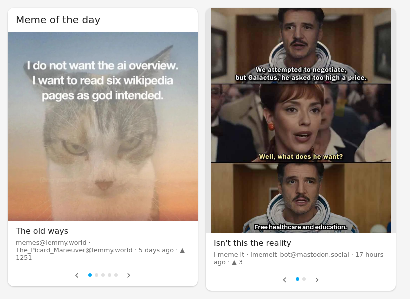

# Fediverse Feed

A Home Assistant integration and dashboard card that shows the top pictures of a
**Lemmy** community, a **Mastodon** hashtag or account, or a **Pixelfed** feed – for
example the meme of the day from `memes@lemmy.world`.



- Source, community/hashtag/account and server as free text in the card editor
- Sort by **Top** (hour, day, week, month, year, all time), **Hot**, **New** or **Active**
- One post (“picture of the day”) or several to swipe through, optionally rotating
- NSFW posts hidden unless switched on; videos are always skipped
- Each feed is fetched at most every 30 minutes, however many cards or browsers show it
- The integration serves the card itself: no dashboard resource to add
- Texts follow the Home Assistant language (German or English)

## Installation

### HACS

1. In HACS, open the menu (⋮) → **Custom repositories**.
2. Add `https://github.com/DevHovAI/fediverse-feed` with type **Integration**.
3. Search for **Fediverse Feed**, download it and restart Home Assistant.

### Manual

Copy `custom_components/fediverse_feed` to `<config>/custom_components/` and restart
Home Assistant.

## Setup

*Settings → Devices & services → Add integration → Fediverse Feed.*

Lemmy and Mastodon need no account. **Pixelfed** servers only answer with an access
token:

1. Log in to your Pixelfed server, open **Settings → Applications** (`/settings/applications`).
2. Under **Personal Access Tokens** create a token with the scope `read`.
3. Enter the server (e.g. `pixelfed.social`) and the token in the integration.

A Mastodon token is only needed for servers that hide their public timelines. Tokens
can be changed later with **Configure**; they never leave Home Assistant.

## Card

Reload the browser once after installing, then *Add card → Fediverse Feed*, or in YAML:

```yaml
type: custom:fediverse-feed-card
source: lemmy
query: memes
sort: top
period: day
```

| Option | Default | Description |
|---|---|---|
| `source` | `lemmy` | `lemmy`, `mastodon` or `pixelfed`. |
| `instance` | `lemmy.world` / `mastodon.social` / `pixelfed.social` | Server to ask. |
| `query` | `memes` | Lemmy: community (`memes`, `memes@lemmy.ml`), empty = whole server. Mastodon/Pixelfed: `#hashtag`, `@account` or `@account@server`; empty = trending posts (Mastodon) or the public timeline (Pixelfed). |
| `sort` | `top` | `top`, `hot`, `new`, `active` (Lemmy only). |
| `period` | `day` | For `top`: `hour`, `day`, `week`, `month`, `year`, `all`. |
| `count` | `1` | Number of posts, up to 20. More than one adds arrows and dots; swipe on the picture. |
| `rotate` | `0` | Show the next post every … seconds; `0` = off. |
| `nsfw` | `false` | Show posts marked NSFW (Lemmy) or sensitive (Mastodon/Pixelfed). |
| `images_only` | `true` | Skip posts without a picture. |
| `show_title` | `true` | Post title. |
| `show_meta` | `true` | Community or account, author, age and score. |
| `show_text` | `false` | Post text. |
| `max_height` | `450` | Maximum picture height in pixels. |
| `title` | – | Card title. |

Tapping the picture or the title opens the post.

### How “Top” works

Lemmy sorts on the server. Mastodon and Pixelfed have no “top of the day”: the
integration fetches up to 120 recent posts of the hashtag or account, keeps those of
the chosen period and sorts them by favourites plus boosts. For a busy hashtag, “week”
or longer may therefore only cover the newest part of the period.

## Why not Reddit?

Reddit switches off its RSS feeds on 13 November 2026 and no longer grants API access
to personal projects, so there is no way left to read it without scraping.

## Development

```sh
uv venv -p 3.14 .venv && uv pip install -p .venv -r requirements-dev.txt
just check
```

## License

MIT
